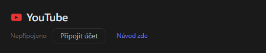
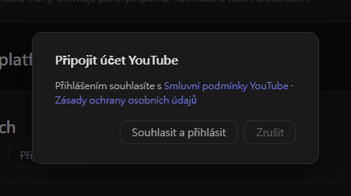
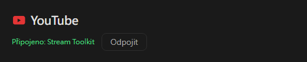

# Nastavení YouTube (nové)

Stream Toolkit připojí váš kanál YouTube přihlášením přes Google, takže nemusíte vytvářet ani zadávat žádný klíč API.

## Krok 1: Připojte účet YouTube

1. Otevřete Stream Toolkit
2. Klikněte na **Nastavení** v levém dolním menu
3. V sekci Připojení platforem najděte **YouTube** a klikněte na **Připojit účet**

   

4. Otevře se potvrzovací okno. Přečtěte si Smluvní podmínky YouTube a Zásady ochrany osobních údajů a klikněte na **Souhlasit a přihlásit**

   

5. Prohlížeč otevře přihlašovací stránku Google. Vyberte účet Google, kterému patří váš kanál YouTube (pokud má účet více kanálů, vyberte ten, na kterém streamujete)
6. Zkontrolujte požadovaná oprávnění a klikněte na **Pokračovat** / **Povolit**

Po dokončení se v řádku YouTube v Nastavení zobrazí **Připojeno: název kanálu**.

## Odpojení

Klikněte na **Odpojit** vedle YouTube. Tím se zároveň odebere přístup Stream Toolkit z vašeho účtu Google.

## Často kladené otázky

**Q: Potřebuji ještě klíč API pro YouTube?**
Ne. Stačí se přihlásit přes Google.

**Q: Přihlásil(a) jsem se ke špatnému kanálu**
Klikněte na **Odpojit**, poté se připojte znovu a vyberte správný účet nebo kanál.

**Q: Po přihlášení v prohlížeči se nic nestane**
Během přihlašování nechte Stream Toolkit otevřený – prohlížeč mu odešle výsledek. Pokud se stav stále neaktualizuje, klikněte znovu na **Připojit účet**.
