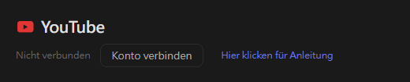
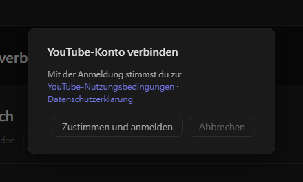
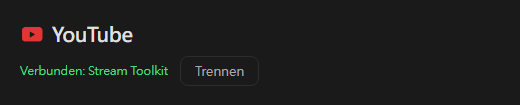

# YouTube Einstellungen (neu)

Stream Toolkit verbindet deinen YouTube-Kanal über die Anmeldung mit Google – du musst also keinen API-Schlüssel erstellen oder eingeben.

## Schritt 1: YouTube-Konto verbinden

1. Öffne Stream Toolkit
2. Klicke im Menü unten links auf **Einstellungen**
3. Suche **YouTube** unter Plattformverbindung und klicke auf **Konto verbinden**

   

4. Ein Bestätigungsfenster öffnet sich. Lies die YouTube-Nutzungsbedingungen und die Datenschutzerklärung und klicke dann auf **Zustimmen und anmelden**

   

5. Der Browser öffnet die Google-Anmeldeseite. Wähle das Google-Konto, dem dein YouTube-Kanal gehört (hat das Konto mehrere Kanäle, wähle den, auf dem du streamst)
6. Prüfe die angeforderten Berechtigungen und klicke auf **Weiter** / **Zulassen**

Danach zeigt die YouTube-Zeile in den Einstellungen **Verbunden: Kanalname** an.

## Trennen

Klicke neben YouTube auf **Trennen**. Dadurch wird auch der Zugriff von Stream Toolkit aus deinem Google-Konto entfernt.

## Häufig gestellte Fragen (FAQ)

**Q: Brauche ich noch einen YouTube-API-Schlüssel?**
Nein. Die Anmeldung mit Google ist alles, was du brauchst.

**Q: Ich habe mich mit dem falschen Kanal angemeldet**
Klicke auf **Trennen**, verbinde dich dann erneut und wähle das richtige Konto bzw. den richtigen Kanal.

**Q: Nach der Anmeldung im Browser passiert nichts**
Lass Stream Toolkit während der Anmeldung geöffnet – der Browser sendet das Ergebnis an die App zurück. Ändert sich trotzdem nichts, klicke erneut auf Konto verbinden.
