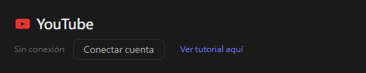
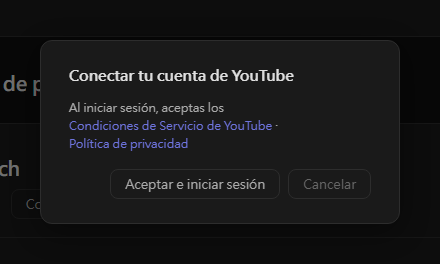
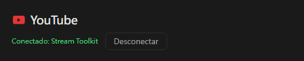

# Ajustes de YouTube (nuevo)

Stream Toolkit conecta tu canal de YouTube iniciando sesión con Google, así que no tienes que crear ni introducir ninguna clave de API.

## Paso 1: Conectar la cuenta de YouTube

1. Abre Stream Toolkit
2. Haz clic en **Ajustes** en el menú de la parte inferior izquierda
3. Busca **YouTube** en **Conexión de plataformas** y haz clic en **Conectar cuenta**

   

4. Se abre una ventana de confirmación. Lee las Condiciones del Servicio de YouTube y la Política de privacidad y haz clic en **Aceptar e iniciar sesión**

   

5. El navegador abre la página de inicio de sesión de Google. Elige la cuenta de Google propietaria de tu canal de YouTube (si la cuenta tiene varios canales, elige el que usas para emitir)
6. Revisa los permisos solicitados y haz clic en **Continuar** / **Permitir**

Al terminar, la fila de YouTube en Ajustes muestra **Conectado: nombre del canal**.

## Desconectar

Haz clic en **Desconectar** junto a YouTube. Esto también retira el acceso de Stream Toolkit a tu cuenta de Google.

## Preguntas frecuentes

**Q: ¿Sigo necesitando una clave de API de YouTube?**
No. Basta con iniciar sesión con Google.

**Q: He iniciado sesión con el canal equivocado**
Haz clic en **Desconectar**, vuelve a conectar y elige la cuenta o el canal correctos.

**Q: No pasa nada después de iniciar sesión en el navegador**
Mantén Stream Toolkit abierto mientras inicias sesión: el navegador le envía el resultado. Si aun así no se actualiza, vuelve a hacer clic en **Conectar cuenta**.
