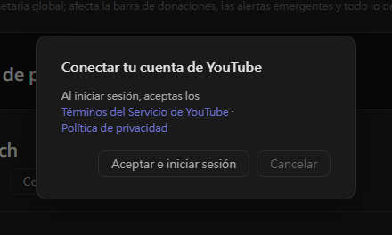

# Configuración de YouTube (nuevo)

Stream Toolkit conecta tu canal de YouTube iniciando sesión con Google, así que no necesitas crear ni ingresar una clave de API.

## Paso 1: Conectar la cuenta de YouTube

1. Abre Stream Toolkit
2. Haz clic en **Configuración** en el menú de la parte inferior izquierda
3. Busca **YouTube** en Conexión de plataformas y haz clic en **Conectar cuenta**

   

4. Se abre una ventana de confirmación. Lee los Términos del Servicio de YouTube y la Política de privacidad y haz clic en **Aceptar e iniciar sesión**

   

5. El navegador abre la página de inicio de sesión de Google. Elige la cuenta de Google dueña de tu canal de YouTube (si la cuenta tiene varios canales, elige el que usas para transmitir)
6. Revisa los permisos solicitados y haz clic en **Continuar** / **Permitir**

Al terminar, la fila de YouTube en Configuración muestra **Conectado: nombre del canal**.

## Desconectar

Haz clic en **Desconectar** junto a YouTube. Esto también quita el acceso de Stream Toolkit de tu cuenta de Google.

## Preguntas frecuentes

**Q: ¿Todavía necesito una clave de API de YouTube?**
No. Solo tienes que iniciar sesión con Google.

**Q: Inicié sesión con el canal equivocado**
Haz clic en **Desconectar** y vuelve a conectar eligiendo la cuenta o el canal correcto.

**Q: No pasa nada después de iniciar sesión en el navegador**
Mantén Stream Toolkit abierto mientras inicias sesión: el navegador le devuelve el resultado. Si aun así no se actualiza, vuelve a hacer clic en Conectar cuenta.
