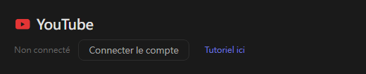
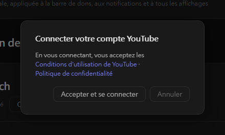
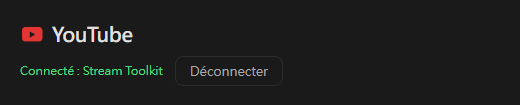

# Réglages YouTube (nouveau)

Stream Toolkit connecte votre chaîne YouTube via la connexion avec Google : aucune clé API à créer ni à saisir.

## Étape 1 : Connecter le compte YouTube

1. Ouvrez Stream Toolkit
2. Cliquez sur **Réglages** dans le menu en bas à gauche
3. Trouvez **YouTube** sous **Connexion des plateformes** et cliquez sur **Connecter le compte**

   

4. Une fenêtre de confirmation s'ouvre. Lisez les Conditions d'utilisation de YouTube et les Règles de confidentialité, puis cliquez sur **Accepter et se connecter**

   

5. Le navigateur ouvre la page de connexion Google. Choisissez le compte Google propriétaire de votre chaîne YouTube (si le compte possède plusieurs chaînes, choisissez celle sur laquelle vous streamez)
6. Vérifiez les autorisations demandées et cliquez sur **Continuer** / **Autoriser**

Une fois terminé, la ligne YouTube des Réglages affiche **Connecté : nom de la chaîne**.

## Déconnexion

Cliquez sur **Déconnecter** à côté de YouTube. Cela retire également l'accès de Stream Toolkit à votre compte Google.

## Questions fréquentes

**Q : Ai-je encore besoin d'une clé API YouTube ?**
Non. Il suffit de vous connecter avec Google.

**Q : Je me suis connecté avec la mauvaise chaîne**
Cliquez sur **Déconnecter**, puis reconnectez-vous en choisissant le bon compte ou la bonne chaîne.

**Q : Rien ne se passe après la connexion dans le navigateur**
Gardez Stream Toolkit ouvert pendant la connexion : le navigateur lui renvoie le résultat. Si rien ne change, cliquez de nouveau sur **Connecter le compte**.
