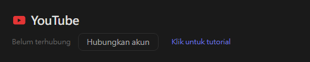
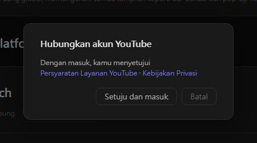
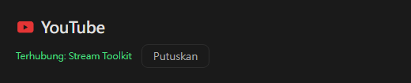

# Pengaturan YouTube (Baru)

Stream Toolkit menghubungkan channel YouTube Anda melalui masuk dengan Google, jadi tidak perlu membuat atau mengisi API key.

## Langkah 1: Hubungkan Akun YouTube

1. Buka Stream Toolkit
2. Klik **Pengaturan** pada menu kiri bawah
3. Temukan **YouTube** di bawah Koneksi Platform dan klik **Hubungkan akun**

   

4. Jendela konfirmasi akan terbuka. Baca Persyaratan Layanan YouTube dan Kebijakan Privasi, lalu klik **Setuju dan masuk**

   

5. Browser membuka halaman masuk Google. Pilih akun Google pemilik channel YouTube Anda (jika akun tersebut memiliki beberapa channel, pilih channel yang Anda gunakan untuk live)
6. Periksa izin yang diminta, lalu klik **Lanjutkan** / **Izinkan**

Setelah selesai, baris YouTube di Pengaturan menampilkan **Terhubung: nama channel**.

## Memutuskan Koneksi

Klik **Putuskan** di samping YouTube. Tindakan ini juga menghapus akses Stream Toolkit dari akun Google Anda.

## Pertanyaan Umum

**Q: Apakah saya masih memerlukan YouTube API key?**
Tidak. Cukup masuk dengan Google.

**Q: Saya masuk dengan channel yang salah**
Klik **Putuskan**, lalu hubungkan lagi dan pilih akun atau channel yang benar.

**Q: Tidak terjadi apa-apa setelah masuk di browser**
Biarkan Stream Toolkit tetap terbuka saat Anda masuk — browser akan mengirimkan hasilnya kembali ke aplikasi. Jika masih belum berubah, klik Hubungkan akun lagi.
