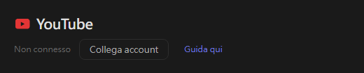
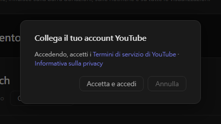
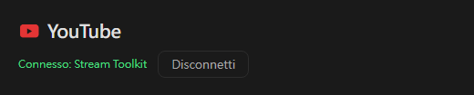

# Impostazioni YouTube (nuovo)

Stream Toolkit collega il tuo canale YouTube tramite l'accesso con Google, quindi non devi creare né inserire alcuna chiave API.

## Passaggio 1: Collega l'account YouTube

1. Apri Stream Toolkit
2. Fai clic su **Impostazioni** nel menu in basso a sinistra
3. Trova **YouTube** in **Collegamento piattaforme** e fai clic su **Collega account**

   

4. Si apre una finestra di conferma. Leggi i Termini di servizio e le Norme sulla privacy di YouTube, poi fai clic su **Accetta e accedi**

   

5. Il browser apre la pagina di accesso di Google. Scegli l'account Google proprietario del tuo canale YouTube (se l'account ha più canali, scegli quello con cui trasmetti)
6. Controlla le autorizzazioni richieste e fai clic su **Continua** / **Consenti**

Al termine, la riga YouTube nelle Impostazioni mostra **Connesso: nome del canale**.

## Disconnessione

Fai clic su **Disconnetti** accanto a YouTube. In questo modo viene rimosso anche l'accesso di Stream Toolkit dal tuo account Google.

## Domande frequenti

**Q: Mi serve ancora una chiave API di YouTube?**
No. Basta accedere con Google.

**Q: Ho effettuato l'accesso con il canale sbagliato**
Fai clic su **Disconnetti**, poi ricollega l'account scegliendo l'account o il canale corretto.

**Q: Dopo l'accesso nel browser non succede nulla**
Tieni aperto Stream Toolkit durante l'accesso: il browser gli invia il risultato. Se ancora non si aggiorna, fai di nuovo clic su Collega account.
