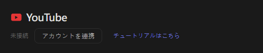
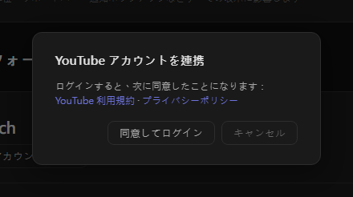
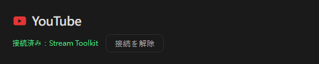

# YouTube 設定（新版）

Stream Toolkit は Google でログインして YouTube チャンネルに接続するため、API Key を作成・入力する必要はありません。

## ステップ 1：YouTube アカウントを連携する

1. Stream Toolkit を開きます
2. 左下のメニューで **設定** をクリックします
3. プラットフォーム連携の **YouTube** を見つけ、**アカウントを連携** をクリックします

   

4. 確認ウィンドウが開きます。YouTube 利用規約とプライバシーポリシーを読み、**同意してログイン** をクリックします

   

5. ブラウザで Google のログインページが開きます。YouTube チャンネルを所有する Google アカウントを選びます（アカウントに複数のチャンネルがある場合は、配信に使うチャンネルを選びます）
6. 要求される権限を確認し、**続行** / **許可** をクリックします

完了すると、設定の YouTube の行に **接続済み：チャンネル名** と表示されます。

## 接続を解除する

YouTube の横にある **接続を解除** をクリックします。これにより、Google アカウントから Stream Toolkit のアクセス権も削除されます。

## よくある質問

**Q：YouTube API Key はまだ必要ですか？**
いいえ。Google でログインするだけで使えます。

**Q：間違ったチャンネルでログインしてしまいました**
**接続を解除** をクリックしてから再度接続し、正しいアカウントまたはチャンネルを選んでください。

**Q：ブラウザでログインした後、何も起きません**
ログイン中は Stream Toolkit を開いたままにしてください。ブラウザが結果を Stream Toolkit に送り返します。それでも更新されない場合は、もう一度 **アカウントを連携** をクリックしてください。
