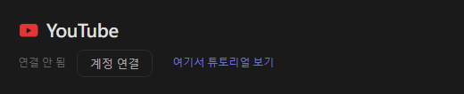
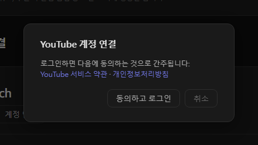
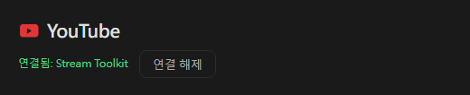

# YouTube 설정 (신규)

Stream Toolkit은 Google 로그인으로 YouTube 채널을 연결하므로 API 키를 만들거나 입력할 필요가 없습니다.

## 1단계: YouTube 계정 연결

1. Stream Toolkit을 엽니다
2. 왼쪽 아래 메뉴에서 **설정**을 클릭합니다
3. 플랫폼 연결에서 **YouTube**를 찾아 **계정 연결**을 클릭합니다

   

4. 확인 창이 열립니다. YouTube 서비스 약관과 개인정보처리방침을 읽은 후 **동의하고 로그인**을 클릭합니다

   

5. 브라우저에서 Google 로그인 페이지가 열립니다. YouTube 채널을 소유한 Google 계정을 선택합니다(계정에 채널이 여러 개 있으면 방송하는 채널을 선택합니다)
6. 요청된 권한을 확인하고 **계속** / **허용**을 클릭합니다

완료되면 설정의 YouTube 행에 **연결됨: 채널 이름**이 표시됩니다.

## 연결 해제

YouTube 옆의 **연결 해제**를 클릭합니다. Google 계정에서 Stream Toolkit의 액세스 권한도 함께 제거됩니다.

## 자주 묻는 질문

**Q: YouTube API 키가 아직 필요한가요?**
아니요. Google 로그인만 하면 됩니다.

**Q: 다른 채널로 로그인했어요**
**연결 해제**를 클릭한 후 다시 연결하고 올바른 계정 또는 채널을 선택하세요.

**Q: 브라우저에서 로그인한 후 아무런 반응이 없나요?**
로그인하는 동안 Stream Toolkit을 열어 두세요. 브라우저가 결과를 Stream Toolkit으로 보냅니다. 그래도 업데이트되지 않으면 계정 연결을 다시 클릭하세요.
