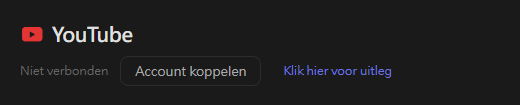
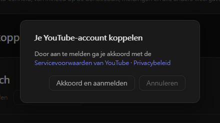
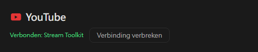

# YouTube-instellingen (nieuw)

Stream Toolkit koppelt je YouTube-kanaal via aanmelden met Google, dus je hoeft geen API-sleutel aan te maken of in te vullen.

## Stap 1: YouTube-account koppelen

1. Open Stream Toolkit
2. Klik op **Instellingen** in het menu linksonder
3. Zoek **YouTube** onder **Platformkoppeling** en klik op **Account koppelen**

   

4. Er opent een bevestigingsvenster. Lees de Servicevoorwaarden van YouTube en het Privacybeleid en klik op **Akkoord en aanmelden**

   

5. De browser opent de aanmeldpagina van Google. Kies het Google-account dat eigenaar is van je YouTube-kanaal (heeft het account meerdere kanalen, kies dan het kanaal waarop je streamt)
6. Controleer de gevraagde machtigingen en klik op **Doorgaan** / **Toestaan**

Daarna toont de YouTube-rij in Instellingen **Verbonden: kanaalnaam**.

## Ontkoppelen

Klik op **Verbinding verbreken** naast YouTube. Hiermee wordt ook de toegang van Stream Toolkit uit je Google-account verwijderd.

## Veelgestelde vragen

**Q: Heb ik nog een YouTube-API-sleutel nodig?**
Nee. Aanmelden met Google is alles wat je nodig hebt.

**Q: Ik heb me aangemeld met het verkeerde kanaal**
Klik op **Verbinding verbreken**, koppel daarna opnieuw en kies het juiste account of kanaal.

**Q: Er gebeurt niets na het aanmelden in de browser**
Houd Stream Toolkit open terwijl je je aanmeldt: de browser stuurt het resultaat terug naar de app. Wordt het nog steeds niet bijgewerkt, klik dan opnieuw op **Account koppelen**.
