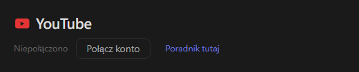
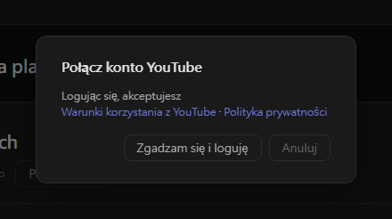
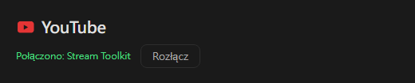

# Ustawienia YouTube (nowe)

Stream Toolkit łączy Twój kanał YouTube przez logowanie Google, więc nie trzeba tworzyć ani wpisywać klucza API.

## Krok 1: Połącz konto YouTube

1. Otwórz Stream Toolkit
2. Kliknij **Ustawienia** w lewym dolnym menu
3. Znajdź **YouTube** w sekcji **Połączenia platform** i kliknij **Połącz konto**

   

4. Otworzy się okno potwierdzenia. Przeczytaj Warunki korzystania z YouTube i Politykę prywatności, a następnie kliknij **Zgadzam się i loguję**

   

5. Przeglądarka otworzy stronę logowania Google. Wybierz konto Google, do którego należy Twój kanał YouTube (jeśli konto ma kilka kanałów, wybierz ten, na którym streamujesz)
6. Sprawdź żądane uprawnienia i kliknij **Dalej** / **Zezwól**

Po zakończeniu wiersz YouTube w Ustawieniach pokaże **Połączono: nazwa kanału**.

## Rozłączanie

Kliknij **Rozłącz** obok YouTube. Spowoduje to również usunięcie dostępu Stream Toolkit z Twojego konta Google.

## Najczęściej zadawane pytania

**Q: Czy nadal potrzebuję klucza API YouTube?**
Nie. Wystarczy zalogować się przez Google.

**Q: Zalogowałem się na niewłaściwy kanał**
Kliknij **Rozłącz**, a następnie połącz ponownie i wybierz właściwe konto lub kanał.

**Q: Po zalogowaniu w przeglądarce nic się nie dzieje**
Podczas logowania nie zamykaj Stream Toolkit — przeglądarka przekazuje do niego wynik. Jeśli nadal nic się nie zmienia, kliknij ponownie **Połącz konto**.
