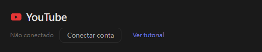
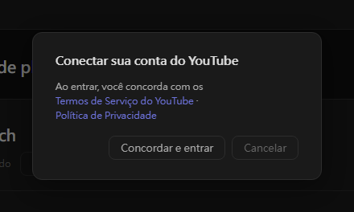

# Configurações do YouTube (novo)

O Stream Toolkit conecta seu canal do YouTube pelo login com o Google, então não é preciso criar nem inserir nenhuma chave de API.

## Passo 1: Conectar a conta do YouTube

1. Abra o Stream Toolkit
2. Clique em **Configurações** no menu inferior esquerdo
3. Encontre **YouTube** em **Conexão de plataformas** e clique em **Conectar conta**

   

4. Uma janela de confirmação é aberta. Leia os Termos de Serviço do YouTube e a Política de Privacidade e clique em **Concordar e entrar**

   

5. O navegador abre a página de login do Google. Escolha a conta do Google dona do seu canal do YouTube (se a conta tiver vários canais, escolha aquele em que você faz as lives)
6. Confira as permissões solicitadas e clique em **Continuar** / **Permitir**

Ao terminar, a linha do YouTube nas Configurações mostra **Conectado: nome do canal**.

## Desconectar

Clique em **Desconectar** ao lado do YouTube. Isso também remove o acesso do Stream Toolkit da sua conta do Google.

## Perguntas frequentes

**Q: Ainda preciso de uma chave de API do YouTube?**
Não. Basta entrar com o Google.

**Q: Entrei com o canal errado**
Clique em **Desconectar** e conecte de novo, escolhendo a conta ou o canal certo.

**Q: Nada acontece depois de entrar pelo navegador**
Mantenha o Stream Toolkit aberto durante o login: o navegador devolve o resultado para ele. Se ainda não atualizar, clique em **Conectar conta** de novo.
