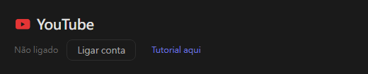
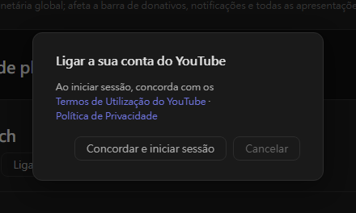
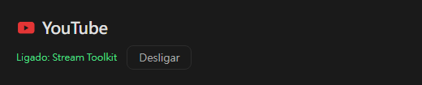

# Definições do YouTube (novo)

O Stream Toolkit liga o seu canal do YouTube através do início de sessão com a Google, pelo que não é preciso criar nem introduzir uma chave de API.

## Passo 1: Ligar a conta do YouTube

1. Abra o Stream Toolkit
2. Clique em **Definições** no menu inferior esquerdo
3. Encontre o **YouTube** em **Ligações de plataforma** e clique em **Ligar conta**

   

4. Abre-se uma janela de confirmação. Leia os Termos de Utilização e a Política de Privacidade do YouTube e clique em **Concordar e iniciar sessão**

   

5. O navegador abre a página de início de sessão da Google. Escolha a conta Google proprietária do seu canal do YouTube (se a conta tiver vários canais, escolha aquele em que transmite)
6. Reveja as permissões pedidas e clique em **Continuar** / **Permitir**

No fim, a linha do YouTube nas Definições mostra **Ligado: nome do canal**.

## Desligar

Clique em **Desligar** junto ao YouTube. Isto também remove o acesso do Stream Toolkit da sua conta Google.

## Perguntas frequentes

**Q: Ainda preciso de uma chave de API do YouTube?**
Não. Basta iniciar sessão com a Google.

**Q: Iniciei sessão com o canal errado**
Clique em **Desligar** e volte a ligar, escolhendo a conta ou o canal correto.

**Q: Nada acontece depois de iniciar sessão no navegador**
Mantenha o Stream Toolkit aberto enquanto inicia sessão — o navegador devolve-lhe o resultado. Se mesmo assim não atualizar, clique novamente em **Ligar conta**.
