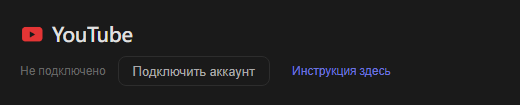
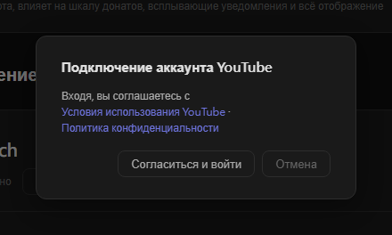
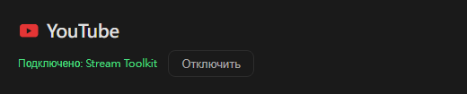

# Настройки YouTube (новое)

Stream Toolkit подключает ваш канал YouTube через вход в Google, поэтому создавать и вводить API-ключ не нужно.

## Шаг 1: Подключите аккаунт YouTube

1. Откройте Stream Toolkit
2. Нажмите **Настройки** в левом нижнем меню
3. Найдите **YouTube** в разделе «Подключение платформ» и нажмите **Подключить аккаунт**

   

4. Откроется окно подтверждения. Прочитайте Условия использования YouTube и Политику конфиденциальности, затем нажмите **Согласиться и войти**

   

5. В браузере откроется страница входа Google. Выберите аккаунт Google, которому принадлежит ваш канал YouTube (если у аккаунта несколько каналов, выберите тот, на котором вы ведёте трансляции)
6. Проверьте запрашиваемые разрешения и нажмите **Продолжить** / **Разрешить**

После этого в строке YouTube в настройках появится **Подключено: название канала**.

## Отключение

Нажмите **Отключить** рядом с YouTube. Доступ Stream Toolkit также будет удалён из вашего аккаунта Google.

## Часто задаваемые вопросы

**Q: Нужен ли ещё API-ключ YouTube?**
Нет. Достаточно войти через Google.

**Q: Я вошёл не с тем каналом**
Нажмите **Отключить**, затем подключитесь снова и выберите нужный аккаунт или канал.

**Q: После входа в браузере ничего не происходит**
Не закрывайте Stream Toolkit во время входа — браузер передаёт результат обратно в приложение. Если ничего не изменилось, снова нажмите «Подключить аккаунт».
