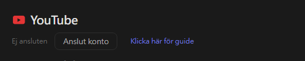
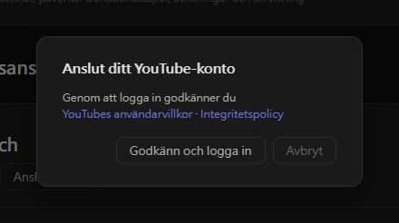
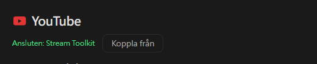

# YouTube-inställningar (ny)

Stream Toolkit ansluter din YouTube-kanal genom inloggning med Google, så du behöver inte skapa eller ange någon API-nyckel.

## Steg 1: Anslut YouTube-konto

1. Öppna Stream Toolkit
2. Klicka på **Inställningar** i menyn nere till vänster
3. Hitta **YouTube** under **Plattformsanslutning** och klicka på **Anslut konto**

   

4. Ett bekräftelsefönster öppnas. Läs YouTubes användarvillkor och integritetspolicy och klicka sedan på **Godkänn och logga in**

   

5. Webbläsaren öppnar Googles inloggningssida. Välj det Google-konto som äger din YouTube-kanal (om kontot har flera kanaler väljer du den du streamar på)
6. Granska de begärda behörigheterna och klicka på **Fortsätt** / **Tillåt**

När det är klart visar YouTube-raden i Inställningar **Ansluten: kanalnamn**.

## Koppla från

Klicka på **Koppla från** bredvid YouTube. Då tas även Stream Toolkits åtkomst bort från ditt Google-konto.

## Vanliga frågor

**Q: Behöver jag fortfarande en YouTube-API-nyckel?**
Nej. Det räcker att logga in med Google.

**Q: Jag loggade in med fel kanal**
Klicka på **Koppla från**, anslut sedan igen och välj rätt konto eller kanal.

**Q: Inget händer efter inloggningen i webbläsaren**
Låt Stream Toolkit vara öppet medan du loggar in — webbläsaren skickar tillbaka resultatet till appen. Om inget uppdateras ändå klickar du på **Anslut konto** igen.
