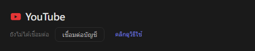
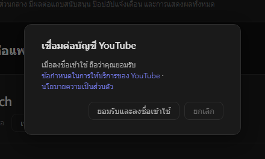
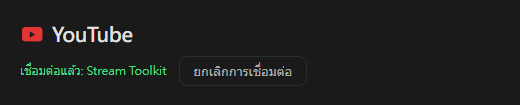

# การตั้งค่า YouTube (ใหม่)

Stream Toolkit เชื่อมต่อช่อง YouTube ของคุณด้วยการลงชื่อเข้าใช้ Google จึงไม่ต้องสร้างหรือกรอก API Key

## ขั้นตอนที่ 1: เชื่อมต่อบัญชี YouTube

1. เปิด Stream Toolkit
2. คลิก **ตั้งค่า** ในเมนูด้านซ้ายล่าง
3. ค้นหา **YouTube** ในส่วน การเชื่อมต่อแพลตฟอร์ม แล้วคลิก **เชื่อมต่อบัญชี**

   

4. หน้าต่างยืนยันจะเปิดขึ้น อ่านข้อกำหนดในการให้บริการของ YouTube และนโยบายความเป็นส่วนตัว แล้วคลิก **ยอมรับและลงชื่อเข้าใช้**

   

5. เบราว์เซอร์จะเปิดหน้าลงชื่อเข้าใช้ Google ให้เลือกบัญชี Google ที่เป็นเจ้าของช่อง YouTube ของคุณ (หากบัญชีมีหลายช่อง ให้เลือกช่องที่คุณใช้ไลฟ์)
6. ตรวจสอบสิทธิ์ที่ขอ แล้วคลิก **ดำเนินการต่อ** / **อนุญาต**

เมื่อเสร็จแล้ว แถว YouTube ในหน้าตั้งค่าจะแสดง **เชื่อมต่อแล้ว: ชื่อช่อง**

## ยกเลิกการเชื่อมต่อ

คลิก **ยกเลิกการเชื่อมต่อ** ข้าง YouTube ระบบจะลบสิทธิ์เข้าถึงของ Stream Toolkit ออกจากบัญชี Google ของคุณด้วย

## คำถามที่พบบ่อย

**Q: ยังต้องใช้ YouTube API Key อยู่ไหม?**
ไม่ต้อง แค่ลงชื่อเข้าใช้ด้วย Google ก็พอ

**Q: ลงชื่อเข้าใช้ผิดช่อง**
คลิก **ยกเลิกการเชื่อมต่อ** แล้วเชื่อมต่อใหม่อีกครั้ง โดยเลือกบัญชีหรือช่องที่ถูกต้อง

**Q: ลงชื่อเข้าใช้ในเบราว์เซอร์แล้วแต่ไม่มีอะไรเกิดขึ้น**
เปิด Stream Toolkit ค้างไว้ระหว่างลงชื่อเข้าใช้ เพราะเบราว์เซอร์จะส่งผลลัพธ์กลับไปที่โปรแกรม หากยังไม่อัปเดต ให้คลิก เชื่อมต่อบัญชี อีกครั้ง
