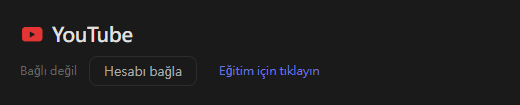
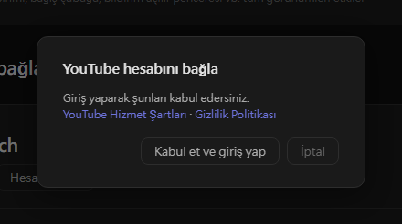
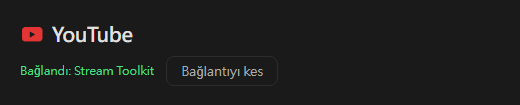

# YouTube Ayarlar (Yeni)

Stream Toolkit, YouTube kanalınızı Google ile giriş yaparak bağlar; bu nedenle oluşturmanız veya girmeniz gereken bir API anahtarı yoktur.

## Adım 1: YouTube Hesabını Bağla

1. Stream Toolkit'ı açın
2. Sol alt menüdeki **Ayarlar** seçeneğine tıklayın
3. **Platform bağlantısı** altında **YouTube** seçeneğini bulun ve **Hesabı bağla** butonuna tıklayın

   

4. Bir onay penceresi açılır. **YouTube Hizmet Şartları** ile **Gizlilik Politikası**'nı okuyun, ardından **Kabul et ve giriş yap** butonuna tıklayın

   

5. Tarayıcı Google giriş sayfasını açar. YouTube kanalınızın sahibi olan Google hesabını seçin (hesapta birden fazla kanal varsa yayın yaptığınız kanalı seçin)
6. İstenen izinleri gözden geçirin ve **Devam** / **İzin ver** butonuna tıklayın

İşlem tamamlandığında Ayarlar'daki YouTube satırında **Bağlandı: kanal adı** görünür.

## Bağlantıyı kesme

YouTube'un yanındaki **Bağlantıyı kes** butonuna tıklayın. Bu işlem Stream Toolkit'ın Google hesabınızdaki erişimini de kaldırır.

## Sıkça Sorulan Sorular

**Q: Hâlâ bir YouTube API anahtarına ihtiyacım var mı?**
Hayır. Google ile giriş yapmanız yeterlidir.

**Q: Yanlış kanalla giriş yaptım**
**Bağlantıyı kes** butonuna tıklayın, ardından tekrar bağlanıp doğru hesabı veya kanalı seçin.

**Q: Tarayıcıda giriş yaptıktan sonra hiçbir şey olmuyor**
Giriş yaparken Stream Toolkit'ı açık tutun; tarayıcı sonucu uygulamaya geri gönderir. Yine de güncellenmezse **Hesabı bağla** butonuna tekrar tıklayın.
