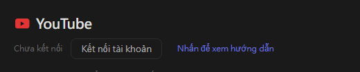
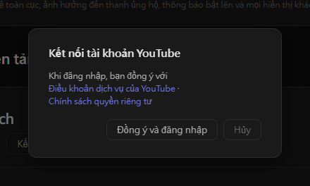
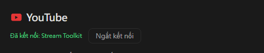

# Cài đặt YouTube (mới)

Stream Toolkit kết nối kênh YouTube của bạn bằng cách đăng nhập Google, vì vậy không cần tạo hay nhập API key.

## Bước 1: Kết nối tài khoản YouTube

1. Mở Stream Toolkit
2. Nhấp vào **Cài đặt** ở menu phía dưới bên trái
3. Tìm **YouTube** trong mục Kết nối nền tảng và nhấp vào **Kết nối tài khoản**

   

4. Cửa sổ xác nhận sẽ mở ra. Đọc Điều khoản dịch vụ của YouTube và Chính sách quyền riêng tư, rồi nhấp **Đồng ý và đăng nhập**

   

5. Trình duyệt mở trang đăng nhập Google. Chọn tài khoản Google sở hữu kênh YouTube của bạn (nếu tài khoản có nhiều kênh, hãy chọn kênh bạn dùng để phát trực tiếp)
6. Kiểm tra các quyền được yêu cầu rồi nhấp **Tiếp tục** / **Cho phép**

Khi hoàn tất, dòng YouTube trong Cài đặt sẽ hiển thị **Đã kết nối: tên kênh**.

## Ngắt kết nối

Nhấp **Ngắt kết nối** bên cạnh YouTube. Thao tác này cũng xóa quyền truy cập của Stream Toolkit khỏi tài khoản Google của bạn.

## Câu hỏi thường gặp

**Q: Tôi có còn cần API key YouTube không?**
Không. Chỉ cần đăng nhập bằng Google là đủ.

**Q: Tôi đã đăng nhập nhầm kênh**
Nhấp **Ngắt kết nối**, sau đó kết nối lại và chọn đúng tài khoản hoặc kênh.

**Q: Đăng nhập trên trình duyệt xong nhưng không có gì xảy ra**
Hãy giữ Stream Toolkit mở trong lúc đăng nhập — trình duyệt sẽ gửi kết quả về ứng dụng. Nếu vẫn không cập nhật, hãy nhấp **Kết nối tài khoản** lần nữa.
