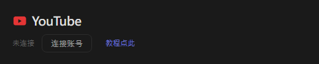
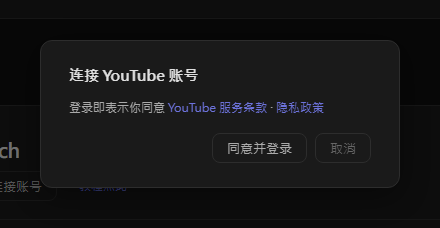
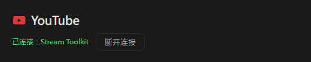

# YouTube 设置（新版）

Stream Toolkit 通过登录 Google 账号连接你的 YouTube 频道，因此不需要创建或填写 API 密钥。

## 步骤一：连接 YouTube 账号

1. 打开 Stream Toolkit
2. 点击左下菜单的 **设置**
3. 在平台连接中找到 **YouTube**，点击 **连接账号**

   

4. 会弹出确认窗口。阅读 YouTube 服务条款与隐私政策后，点击 **同意并登录**

   

5. 浏览器会打开 Google 登录页面。选择拥有你 YouTube 频道的 Google 账号（若该账号下有多个频道，请选择你直播用的那个）
6. 确认请求的权限后，点击 **继续** / **允许**

完成后，设置页中的 YouTube 一行会显示 **已连接：频道名称**。

## 断开连接

点击 YouTube 旁的 **断开连接**。这也会同时移除 Stream Toolkit 对你 Google 账号的访问权限。

## 常见问题

**Q：还需要 YouTube API 密钥吗？**
不需要，登录 Google 就可以了。

**Q：登录到错误的频道了**
点击 **断开连接**，再重新连接并选择正确的账号或频道。

**Q：在浏览器登录后 App 没有反应**
登录时请保持 Stream Toolkit 开着 — 浏览器会把结果传回 App。若仍然没有更新，请再点击一次连接账号。
