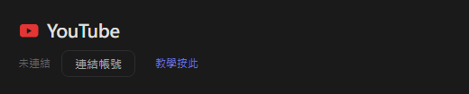
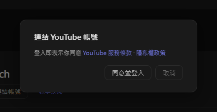
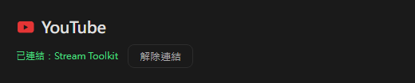

# YouTube 設定（新版）

Stream Toolkit 透過 Google 帳號登入連結你的 YouTube 頻道，不需要申請或填入 API 金鑰。

## 步驟一：連結 YouTube 帳號

1. 開啟 Stream Toolkit
2. 點選左下選單的 **設定**
3. 平台連結中找到 **YouTube**，並點選 **連結帳號**

   

4. 跳出確認視窗，閱讀 YouTube 服務條款與隱私權政策後，點選 **同意並登入**

   

5. 瀏覽器會開啟 Google 登入頁面，選擇擁有你 YouTube 頻道的 Google 帳號（帳號底下有多個頻道時，選擇你直播用的那個）
6. 確認要求的權限後，點選 **繼續**／**允許**

完成後，設定頁的 YouTube 會顯示 **已連結：頻道名稱**。

## 解除連結

點選 YouTube 旁的 **解除連結**，會同時移除 Stream Toolkit 在你 Google 帳戶的存取權。

## 常見問題

**Q：還需要填 YouTube API 金鑰嗎？**
不需要，登入 Google 帳號就可以了。

**Q：登入到錯的頻道了**
點選 **解除連結**，再重新連結並選擇正確的帳號或頻道。

**Q：在瀏覽器登入後 App 沒有反應**
登入時請保持 Stream Toolkit 開著，瀏覽器會把結果傳回 App。如果還是沒有更新，再按一次連結帳號。
